<div align="center">

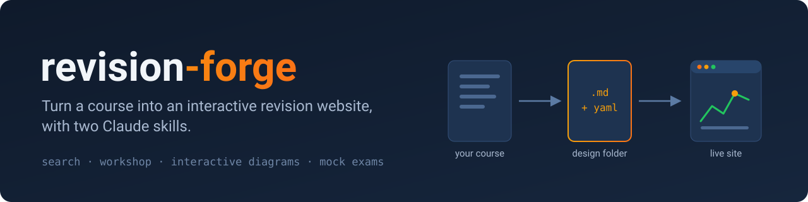

<br>

[](https://support.claude.com/en/articles/12512180-using-skills-in-claude)
[](https://code.claude.com/docs/en/skills)
[](#-what-you-get)
[](#3-deploy-on-netlify)
[](#-what-you-get)

**[Quick start](#-quick-start)** · **[How it works](#-how-it-works)** · **[Updating](#-updating-your-site)** · **[Saving tokens](#-saving-tokens)** · **[Reliable diagrams](#-reliable-interactive-diagrams)**

</div>

---

Drop your lectures, tutorial sheets and past exams into a Claude project. Get back a **live, interactive revision website** built around *your* gaps, with search, drills, animated diagrams and mock exams, deployed for free and updated with a single push.

Nothing is made up: every page comes from your own documents, every number is recomputed by code, and every claim carries a badge saying where it comes from.

<p align="center">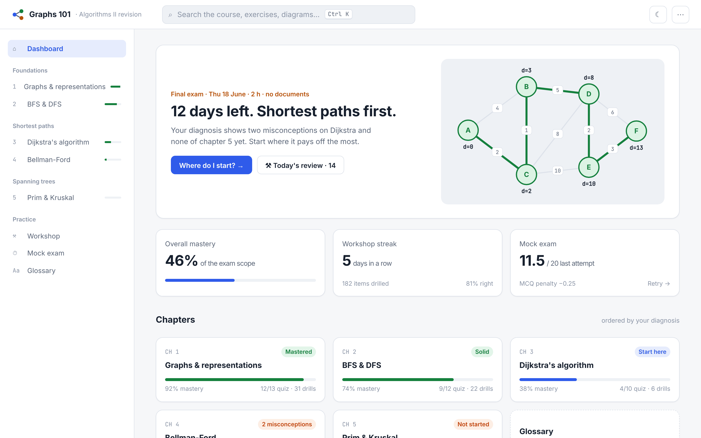</p>

## ✨ What you get

<table>
<tr>
<td width="33%" valign="top">

### 📚 Chapter pages
Intuition, mechanism, exact formulas, pitfalls, worked example, quiz with explained answers, printable key takeaways. Same structure every time.

</td>
<td width="33%" valign="top">

### 🎛️ Interactive diagrams
Animated, step-by-step schemas you manipulate with sliders and buttons, each with a "why" at every step. Built not to break.

</td>
<td width="33%" valign="top">

### 🔍 Global search
On every page, `/` or `Ctrl+K`. Ignores accents, forgives typos, knows your glossary acronyms, jumps to the exact section.

</td>
</tr>
<tr>
<td valign="top">

### 🏋️ Workshop
Drill exercises in series: random-value generators, instant step-by-step marking, "My weak spots" mode, spaced repetition.

</td>
<td valign="top">

### ⏱️ Training mode
A timed mock exam with the real marking scheme (penalty included), or an oral mode with model answers and an examiner view.

</td>
<td valign="top">

### 🎯 Built on your gaps
A short diagnosis sets the chapter order; every misconception gets a warning box, a quiz question and workshop drills.

</td>
</tr>
</table>

Plus: glossary, light/dark theme, phone-friendly layout, progress saved in the browser. No server, no API key, no AI call once online.

## 📸 A look inside

Screenshots from **Graphs 101**, a demo site on graph algorithms (English content, any course works).

<table>
<tr>
<td width="50%" valign="top">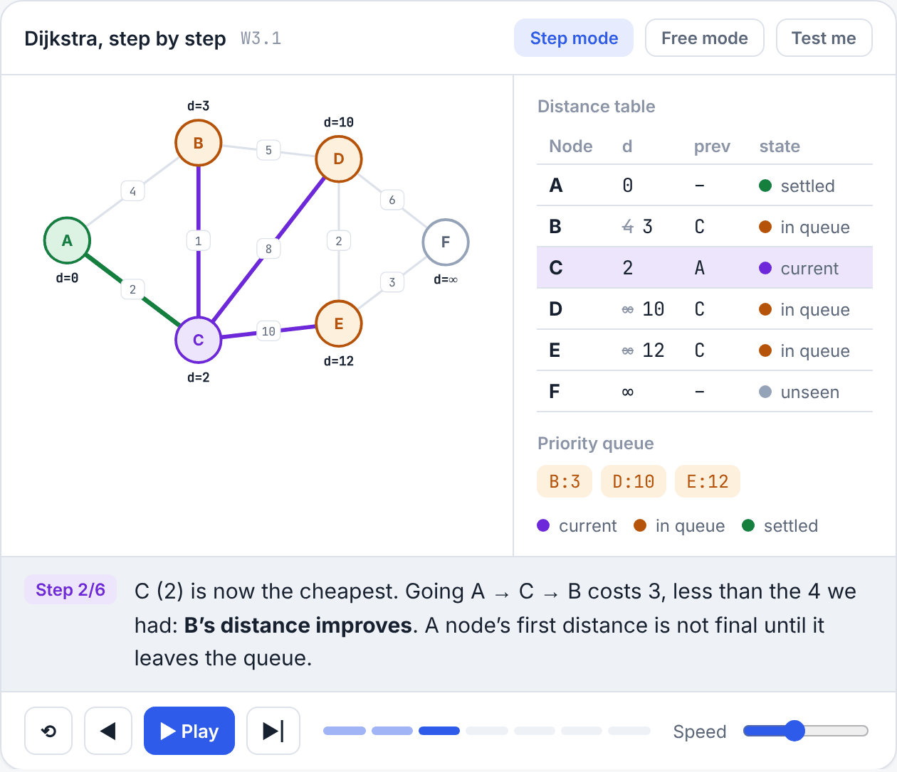<br><b>Interactive diagrams.</b> Step through Dijkstra: the graph, the distance table and the queue update together, with the <i>why</i> of each step.</td>
<td width="50%" valign="top">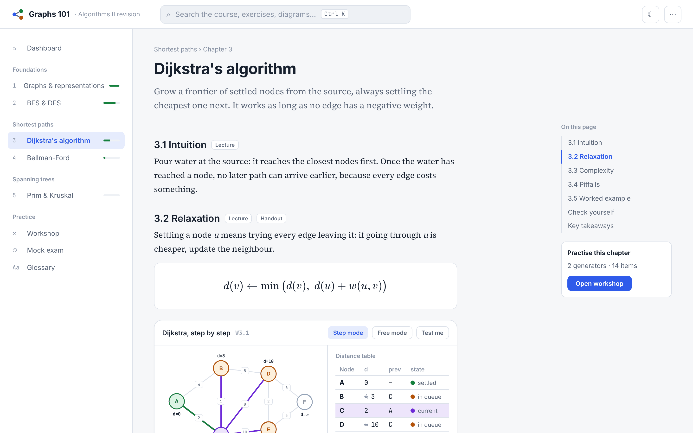<br><b>Chapter pages.</b> Intuition first, exact formulas, origin badges on every section, and a diagram right where it helps.</td>
</tr>
<tr>
<td valign="top">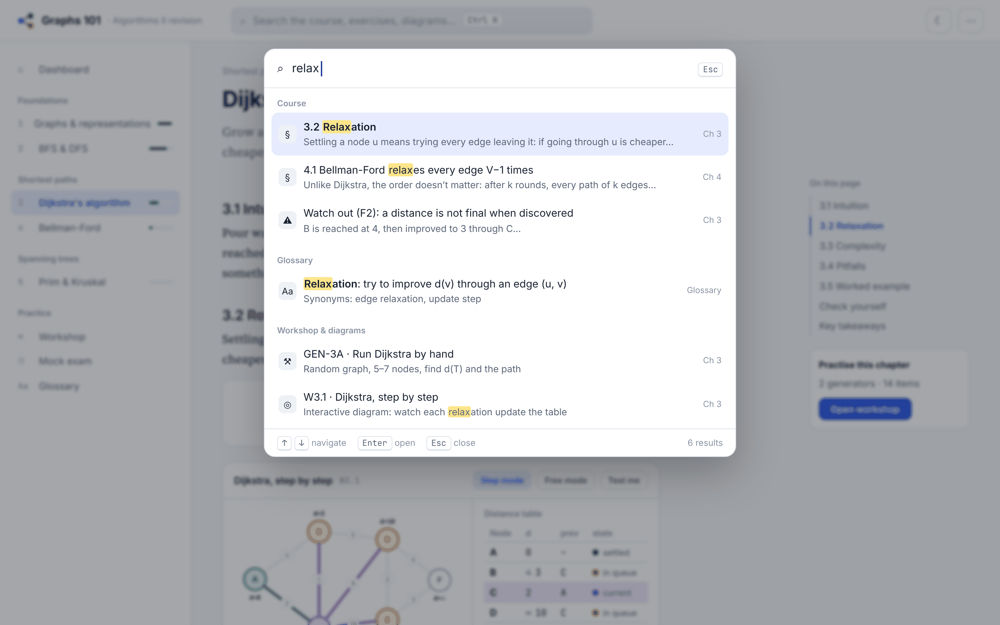<br><b>Global search.</b> <kbd>Ctrl</kbd> <kbd>K</kbd> from anywhere: course sections, glossary, exercises and diagrams, highlighted.</td>
<td valign="top">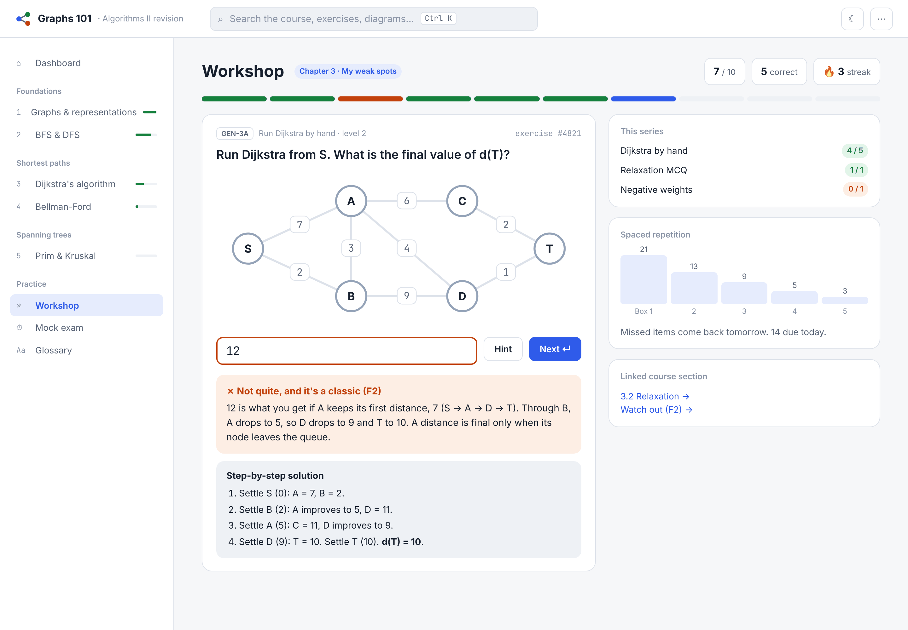<br><b>Workshop.</b> Generated exercises, instant marking, feedback that names the misconception, step-by-step solution, spaced repetition.</td>
</tr>
<tr>
<td valign="top">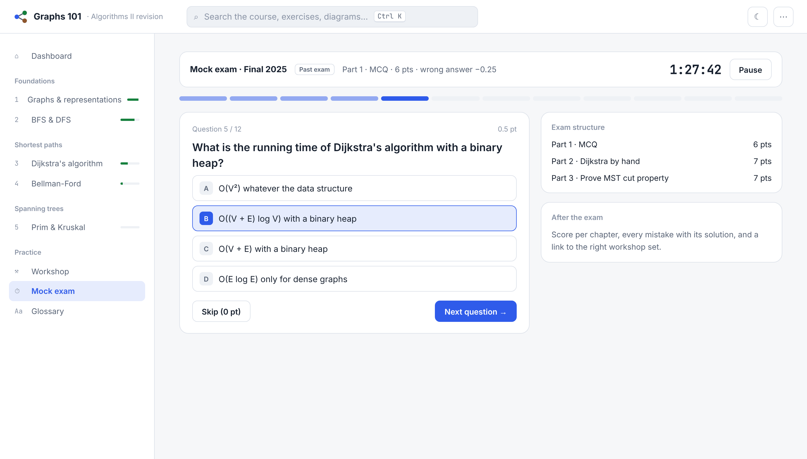<br><b>Mock exam.</b> The real past-exam structure, timer and MCQ penalty, then a per-chapter report.</td>
<td valign="top">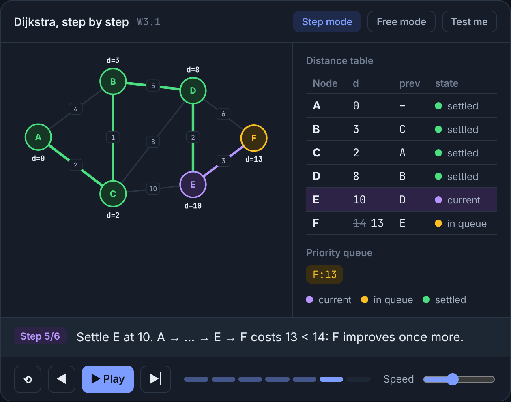<br><b>Dark theme.</b> Diagrams redraw with the theme: no black boxes on light pages, no glare at night.</td>
</tr>
</table>

<details>
<summary><b>📱 On a phone</b></summary>
<br>
<p align="center">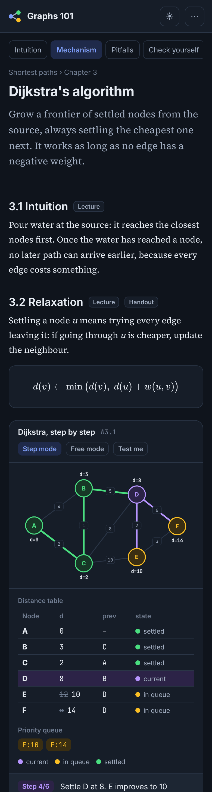</p>
</details>

## 🔧 How it works

Two skills, one for each stage:

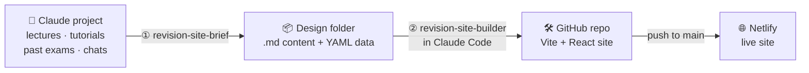

| | Skill | Runs in | Does |
|:-:|---|---|---|
| ① | [`revision-site-brief`](skills/revision-site-brief/SKILL.md) | a **Claude project** | Reads your documents, asks what's missing (scope, exam format, what you already know), verifies every computation with code, and writes a compact design folder, validated by a script before zipping. |
| ② | [`revision-site-builder`](skills/revision-site-builder/SKILL.md) | **Claude Code** on a GitHub repo | Imports the folder by script, builds the site, writes unit and interaction tests, checks the result and pushes to `main`, without stopping to ask. |

Why a Claude project for stage ①? Because the context is already there: your documents, your past conversations, the points you already clarified. The skill turns all of it into a folder Claude Code can follow alone.

## 🚀 Quick start

### 1. Prepare the design folder

1. Create a Claude project for your course and add your documents.
2. In a **new conversation** of that project, ask:
   > *Use the revision-site-brief skill to prepare the design folder for my revision site.*
3. Answer its questions (asked all at once). It can offer a short diagnostic test.
4. Download `<CODE>_for_Claude_Code.zip`, and **add it to the project's files** (the next update needs it).

### 2. Build the site

1. Create an empty GitHub repo and open it in Claude Code.
2. Drop the zip in and write:
   > *Apply the revision-site-builder skill with this folder.*
3. Let it run. You get a report: criteria met, tests, decisions it made alone, what remains.

### 3. Deploy on Netlify

1. On [Netlify](https://www.netlify.com/), create a new site from your GitHub repo.
2. Nothing to configure: `netlify.toml` already sets `npm run build` and `dist`. Keep `main` as production branch.
3. Deploy. From now on, **every push to `main` updates the site.**

> [!NOTE]
> **Language.** The site is built in the language of your course and your conversations: French documents and French chats give a French site. Want another language? Just say so when you ask for the design folder (*"make the site in English"*): it is written into the brief and Claude Code follows it. The design files themselves are in English by default; they are instructions for Claude Code and never appear on the site.

## 📥 Installation

<details>
<summary><b>Skill ① in Claude</b> (claude.ai, desktop or mobile app)</summary>

<br>

1. Enable code execution and file creation in *Settings > Capabilities*.
2. Zip the skill folder, with the folder itself at the root of the zip:
   - **macOS / Linux / Git Bash**: run `./scripts/package-skills.sh`, which writes `dist/revision-site-brief.zip` and `dist/revision-site-builder.zip`;
   - **Windows**: right-click `skills/revision-site-brief` → *Compress to ZIP file* (or *Send to → Compressed folder*).
3. In *Customize > Skills*, click **+** → *Create skill* → *Upload a skill*, and pick `revision-site-brief.zip`.

</details>

<details>
<summary><b>Skill ② in Claude Code</b></summary>

<br>

Pick one:

| Option | How | Best for |
|---|---|---|
| In the site's repo | copy `skills/revision-site-builder/` to `.claude/skills/revision-site-builder/` | simplest, works with Claude Code on the web |
| For all your projects | copy it to `~/.claude/skills/revision-site-builder/` | local Claude Code |
| Through your account | upload `dist/revision-site-builder.zip` like skill ① | skills sync to Claude Code when you sign in with the same account |

Docs: [skills in Claude](https://support.claude.com/en/articles/12512180-using-skills-in-claude) · [skills in Claude Code](https://code.claude.com/docs/en/skills)

</details>

## 🔄 Updating your site

**A small tweak?** Open a fresh Claude Code session on the repo and name what you want changed:

> *Diagram W3.1 freezes when I drag the slider to the end.*

The site's own `CLAUDE.md` tells Claude Code where everything is. It fixes, pushes, Netlify redeploys.

**New lectures or past exams?**

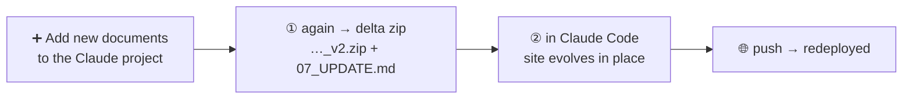

The `_v2` zip only holds what changed, plus a change table (additions, fixes, removals, diagrams you reported as buggy). Content is updated by ID, so **progress saved in the browser is kept**, and search and the workshop pick up the new material automatically.

> [!TIP]
> **Keep every design zip in the project's files** (v1, v2…). Updates rely on the previous version's chapter and exercise IDs to keep them stable. Without it, the skill has to ask you for them.

## 💸 Saving tokens

Building a full site reads and writes a lot. Both skills are designed to spend as little as possible.

| Built in | Why it saves tokens |
|---|---|
| **No duplication between stages** | Generic specs live once in skill ②; the design folder only carries what is specific to your course. |
| **YAML data, imported by script** | Exercises, generators and diagram specs are converted by code instead of retyped, and every value doubles as a test. |
| **Validation by script** | `check_folder.py` checks IDs, cross-references, coverage and leftovers instead of Claude rereading every file. |
| **Short skills, references on demand** | Each `SKILL.md` stays lean; details load only when a step needs them ([progressive disclosure](https://platform.claude.com/docs/en/agents-and-tools/agent-skills/best-practices)). |
| **Lean build session** | Brief read once, short plan, quiet test and build output, generated folders never read, only 5 screenshots, a commit at every milestone. |
| **A short `CLAUDE.md` in every site** | Later sessions start without exploring the repo. |
| **Delta updates** | An update ships only what changed. |

<details>
<summary><b>Habits that help on your side</b></summary>

<br>

From the [Claude Code cost guide](https://code.claude.com/docs/en/costs) and [Anthropic's session tips](https://claude.com/resources/articles/maximizing-the-value-of-your-claude-code-sessions):

- **One task per session.** `/clear` between unrelated tasks (`/rename` first if you want to `/resume` later).
- **Choose model and effort at the start**, not mid-way: switching breaks the prompt cache. A mid-size model is enough for small tweaks; keep the strongest one for the initial build.
- **Don't revive old sessions** after a long break: the cache is gone and the whole conversation is processed again. Start fresh; `CLAUDE.md` carries the context.
- **Name the file or diagram** in your request instead of letting Claude search the repo.
- **Look before you optimise**: `/context` shows what fills the context, `/usage` where usage went; `/mcp` turns off servers you don't need.
- **Keep the Claude project tidy** (remove obsolete files) and generate the folder in a new conversation.
- **Limits are shared** between Claude and Claude Code: a heavy chat session before a build leaves less for the build.

</details>

## 🛡️ Reliable interactive diagrams

The diagrams are the most valuable part of these sites, and the easiest to break. Every one of them:

- [x] is specified with its controls and ranges, steps, edge cases, and reference states computed by code
- [x] keeps its logic in pure, unit-tested functions; the component only renders
- [x] runs a single animation clock, always stopped on pause, page change or hidden tab
- [x] clamps its inputs (never a `NaN` on screen) and is checked at 375 px and in both themes
- [x] sits in its own error boundary: if it crashes, the page keeps working
- [x] has a Playwright test that steps through, spams buttons, pushes sliders to their extremes, resizes, switches theme, leaves mid-animation, and **fails on any console error**

Report a buggy diagram and Claude Code first writes a test that reproduces it, then fixes it.

## 📦 The design folder

| File | Content |
|---|---|
| `00_BRIEF.md` | context, scope, assessment, site specifics, visual direction, decisions, deviations from defaults |
| `01_DIAGNOSIS.md` | what you know, your misconceptions, priority order |
| `02_COURSE_CONTENT.md` | source of truth, chapter by chapter, with origin badges |
| `03_EXERCISES.md` | YAML: quiz, workshop, exam and oral items, generators, exam structures |
| `04_INTERACTIVE_MODULES.md` | YAML: diagram specs, search test queries, training mode |
| `05_…` · `06_GLOSSARY.md` | project sources, glossary (if needed) |
| `07_UPDATE.md` | change table (updates only) |

## 🧭 Principles

| | |
|---|---|
| **Nothing invented** | Content comes only from your documents. Inconsistencies are settled with you or recorded, never resolved silently. |
| **Verified numbers** | Every value is recomputed by code, then becomes an automated test. |
| **Focused on your gaps** | The diagnosis decides what comes first and what gets drilled. |
| **Safe to publish** | The site is public: the skill asks what must not appear and cleans the sources. |

<details>
<summary><b>❓ FAQ</b></summary>

<br>

**Does it work for courses without calculations?**
Yes. Computational chapters get random-value generators; the others get item banks (short answers, fill-in-the-blank, matching, ordering, flashcards). Oral exams and project defences get an oral mode.

**Can my site be in another language than my course?**
Yes. By default it follows your documents and conversations; ask for another language when you request the design folder and it is recorded in the brief.

**Do I need to know React?**
No. Claude Code writes and tests the code. Content lives in separate files, so you can fix a sentence without touching components.

**Can I edit the site by hand?**
Yes. Course content is in `src/content/`; the site's `README.md` explains where everything is.

**What if Claude Code isn't allowed to push to `main`?**
It pushes to the allowed branch and tells you how to merge it or point Netlify at it.

</details>

<details>
<summary><b>🗂️ Repository layout</b></summary>

<br>

```
.
├── README.md
├── assets/
│   ├── banner.svg
│   └── screenshots/                   # demo site used in this README
├── scripts/
│   └── package-skills.sh              # builds dist/<skill>.zip for upload to Claude
└── skills/
    ├── revision-site-brief/           # ① in a Claude project
    │   ├── SKILL.md
    │   ├── references/
    │   │   ├── file-formats.md        # exact formats of files 01-07 (YAML schemas)
    │   │   └── visual-direction.md
    │   ├── templates/
    │   │   └── 00_BRIEF.md
    │   └── scripts/
    │       └── check_folder.py        # validates the folder, then zips it
    └── revision-site-builder/         # ② in Claude Code
        ├── SKILL.md
        └── references/
            ├── site-defaults.md       # pages, training mode, constraints, acceptance criteria
            ├── technical-foundation.md
            ├── search-and-workshop.md
            └── interactive-diagrams.md
```

</details>

## 🤝 Contributing

Issues and pull requests are welcome, especially:

- diagram bugs the reliability rules don't catch yet;
- further token savings;
- feedback from courses in other subjects or languages.

<div align="center">
<br>
<sub>Made for students who'd rather understand than cram.</sub>
</div>
